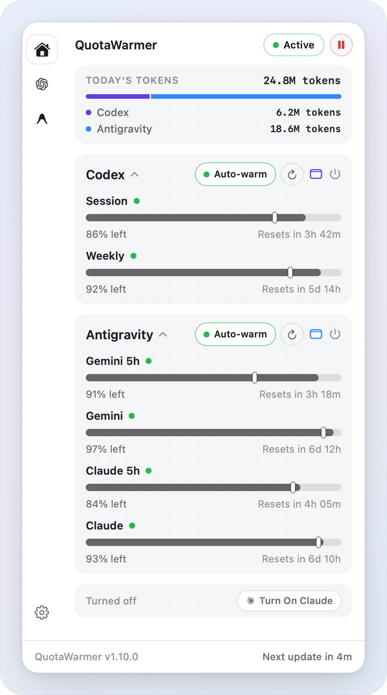
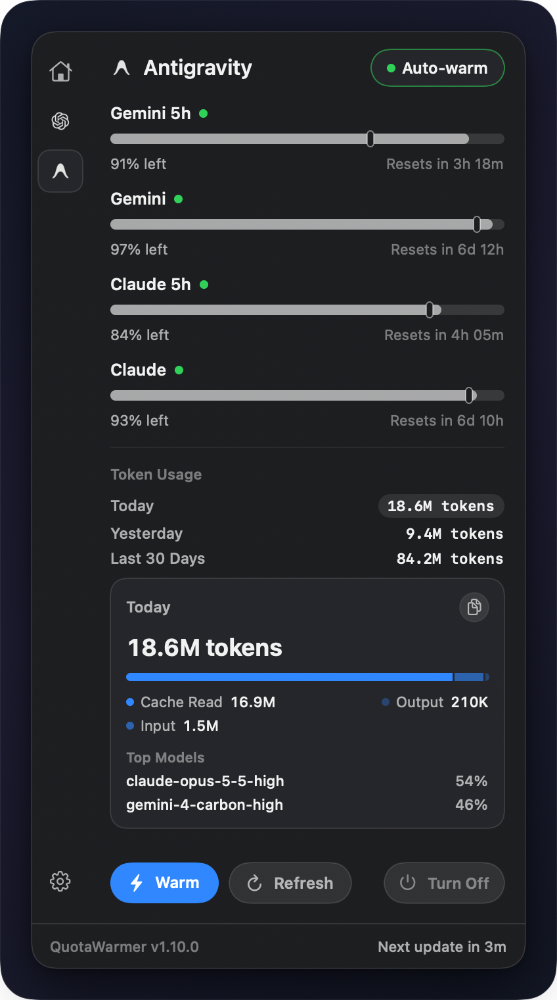

# QuotaWarmer

[English](README.md) | **简体中文**

一个小巧的 macOS 菜单栏应用,帮你把 Claude Code、Codex CLI 和 Antigravity 的 5 小时配额窗口一直"焐热"——它盯着你的滚动配额窗口,窗口一开就自动接手续上,不用你自己记着去用一下才能触发。

<p align="center">
  
  &nbsp;&nbsp;
  
</p>
<p align="center">
  
</p>

默认只**监控**:实时看配额、在菜单栏显示每个工具的窗口状态。把某个工具切到 **Auto-warm**,它就会在窗口一开的瞬间,通过你本机已登录的 CLI 发一条最小化的预热命令,然后再确认一遍窗口是不是真的开了。暂时不用的工具(例如 Claude Code)可以随时主动一键关闭,需要时再一键重新打开。

## 关于这个仓库

这是 [bcanozgur/quota-warmer](https://github.com/bcanozgur/quota-warmer) 的个人 fork。保留它的原因是上游唯一发布过的正式版本带一个凭据相关的 bug(见下方[鸣谢](#鸣谢)),我需要一个不带这个 bug 的版本用在自己每天的自动化上——一台 Mac 早上 7 点自动醒来,把在用的工具都预热好,然后全天自动续窗口,不用我插手。在这个基础上,我把面板重做成跟随系统浅色/深色外观(而不是写死的十六进制颜色)、修掉了反复弹出的钥匙串授权框、加入了 Google Antigravity 支持与每个工具的独立总开关,还让自动续窗口这件事在配额查询接口被限流时也能扛得住——查下来发现这个接口真的会一连限流好几个小时,之前一限流,整个自动续期就跟着停摆。

## 亮点

- **每个工具独立总开关**:暂时不用的工具(如 Claude)可在总览卡片右上角电源按钮、工具详情页、Settings → Providers 或菜单栏右键菜单中一键关闭(从菜单栏、侧边栏和总览隐藏并彻底停止轮询/预热),需要时一键重新打开。
- **已启用工具三档模式**:**Off**(暂停监控)、**Monitor only**(只看不发,默认档)、**Auto-warm**(自动抢开新窗口)。
- **菜单栏一眼看懂状态**:工具图标、时钟式倒计时、剩余配额百分比(支持在设置中切换同时显示/仅百分比/仅倒计时)——健康时安安静静,只有真需要注意时才会亮起彩色角标。
- **同时支持 Claude Code、Codex CLI 和 Antigravity**:三个工具各自独立监控、刷新、预热;Antigravity 完整展示 **Gemini 5h / Gemini / Claude 5h / Claude** 四个配额池,并按需分别预热未开窗的 **Gemini 5h** 与 **Claude 5h**（已开窗的池子自动跳过,不浪费额度）。
- **真实 Token 用量与明细**:总览页提供跨工具 **Today's Tokens** 汇总卡片,各工具详情页展示 **Today / Yesterday / Last 30 Days** 真实 Token 计数,点击任意时间段即可展开 **Cache Read / Input / Output** 与 **Top Models** 占比明细（不展示虚构的订阅折算美元金额）。
- **智能重置调度与防护**:5 小时窗口临近重置时自动提前刷新以第一时间抢开新窗口,并支持**活跃时段护栏（Active Hours）**与低配额提醒。
- **抗限流的自动续期**:实时配额查不到时,会退而求其次去看本地 CLI 的真实活动记录来判断要不要续窗口——配额查询接口被限流,不再连累这个 app 真正该干的事。
- **开窗回执**:预热之后会再查一次配额,确认窗口真的开了,不会出现"命令发了但其实没生效"这种情况自己却不知道。
- **健康监测**:如果 app 哪天真的停止检查配额了,菜单栏和面板会明说,而不是继续装作一切正常。
- **手动控制与轻量历史记录**:面板里可直接手动刷新或预热未开窗配额池,并随时查看最近的配额检查、预热、开窗确认与失败记录。
- **早晨预热与开机自启**:设定时间让 Mac 自动唤醒并抢开当天第一个窗口,安静地驻留在菜单栏,无 Dock 图标。

## 这样用合规吗?

QuotaWarmer 用的是你本来就付费买下的额度,走的是你已经登录的官方 CLI。它不会绕过或提高你的限额,不会分享或上传你的凭据,关闭状态或 Monitor / Off 档位下什么都不会发送。服务商随时可能调整接口规则;如果自动预热哪天不被允许了,把工具切到 Monitor,QuotaWarmer 还是能继续帮你看着配额。

## 工作原理

Claude Code、Codex CLI 和 Antigravity 用的都是 5 小时滚动配额窗口加每周配额上限。如果窗口只能靠你自己想起来去用一下才会开始计时,那有一部分可用时间就白白浪费掉了。

QuotaWarmer 安安静静地跑在菜单栏,定期检查已启用工具的配额状态(对于 Antigravity,优先读取本机运行中的 Antigravity 桌面端 / IDE 本地服务,未打开桌面端时自动走零 token 消耗的 `agy -p /usage --output-format json`)。设成 Auto-warm 的工具,一旦检测到新窗口——不管是通过实时配额读数,还是(在配额接口查不到的情况下)通过"最近本地完全没有活动记录"这个信号——就会在一个隔离的临时工作目录里跑一条最小化的预热命令:

```bash
claude --model haiku --effort low --no-session-persistence --max-turns 1 --tools '' -p 'hi'
codex exec -c model_reasoning_effort="low" --skip-git-repo-check --ephemeral --ignore-rules 'hi'
# Antigravity 通过 `agy models` 动态为每个未开窗的 5h 配额池（Gemini 5h / Claude 5h）选择最低成本模型:
agy --model '<lowest-cost-pool-model>' --print-timeout 45s -p 'hi'
```

Codex 使用你本地配置里的默认模型,Antigravity 则通过 `agy models` 动态发现可用模型（若失败再回退 `agy --effort low --print-timeout 45s -p 'hi'`）,不写死易淘汰的模型名（ChatGPT 账号下的 `gpt-5.4-mini` 曾因下线失效,`agy` 无头模式遇到已下线模型名也会直接报错退出）。装了 ChatGPT.app 的话,优先用它内置的 `codex`,而不是 npm 全局装的那个:npm 装的不会自己更新,旧客户端会被服务端拒绝使用当前的模型。

本地活动与 Token 用量读取自:

```text
~/.claude/projects/*/*.jsonl
~/.codex/sessions/YYYY/MM/DD/*.jsonl           # 同时兼容 archived_sessions/ 与 Codex 远程统计
~/.gemini/antigravity*/conversations/*.db
~/.gemini/antigravity*/brain/*/.system_generated/logs/transcript.jsonl
```

这些日志一方面给界面提供上下文,另一方面——因为它们反映的是真实使用情况而不是一次网络请求——在实时接口失灵的时候,能撑住自动续期的判断。

## 环境要求

| 依赖 | 要求 |
| --- | --- |
| macOS | 14.0 Sonoma 或更高 |
| Xcode | 16+(仅本地编译需要,见下文) |
| Claude Code | 按需安装(关闭 Claude 时无需安装) |
| Codex CLI | 按需安装,在 shell 的 `PATH` 里能找到 |
| Antigravity (`agy`) | 按需安装 Antigravity 应用或 `agy` CLI(1.1.11+) |

## 安装

### 下载 Release

1. 从本仓库的 [Releases](https://github.com/WenjunLi2004/quota-warmer/releases) 下载最新的 `QuotaWarmer-<version>-universal.dmg`。
2. 打开 DMG,把 **QuotaWarmer.app** 拖进 **Applications**。
3. 清除 Gatekeeper 隔离属性(DMG 是 ad-hoc 签名,未经 Apple 公证):
   ```bash
   xattr -dr com.apple.quarantine "/Applications/QuotaWarmer.app"
   ```
   ……或者第一次打开时右键点 **QuotaWarmer.app** 选择"打开"。
4. 从 Applications 里启动它。

### 从源码构建

SwiftUI 的 `@State` 现在靠一个宏插件编译,这个插件只随完整 Xcode 分发,单装 Command Line Tools 编译不出来。

```bash
brew install xcodegen
git clone https://github.com/WenjunLi2004/quota-warmer.git
cd quota-warmer
xcodegen generate
open QuotaWarmer.xcodeproj
```

或者用命令行直接编译:

```bash
xcodebuild -project QuotaWarmer.xcodeproj -scheme QuotaWarmer build
```

### 如何验证一次 Release

这里的每个 DMG 都是这个仓库自己的 `release-unsigned.yml`,在 GitHub 的 macOS runner 上、从打了 tag 的那个具体 commit 编译出来的——不是手工攒的。想核实某个 release 对应哪一份看得见的源码:把那个 tag 的 `project.yml` 和[上游 `main`](https://github.com/bcanozgur/quota-warmer/compare/main...WenjunLi2004:quota-warmer:main) 对比一下,应该只有版本号不一样;再核对下载的 DMG 的 SHA-256 和同一个 release 里发布的 `.sha256` 文件是否一致。

## 两个踩过的坑

**为什么"始终允许"总是不管用,以及现在怎么彻底不弹窗。** Claude Code 是用苹果自带的 `/usr/bin/security` 工具写入凭据的,而每次写入(每次轮换 OAuth 令牌时一次,大约 8 小时)都会把这个条目的 *partition list* 重置成只剩这个工具自己的 `apple-tool:`。通过 Security 框架读取的 app,点了"始终允许"之后仍留在访问列表里,但下一次轮换就会丢掉自己的 partition,所以不管点多少次,弹窗都会按这个周期回来。这个 fork 的早期版本一直忍着这个问题。现在 QuotaWarmer 用和 Claude Code 一样的方式读取,也就是 `/usr/bin/security find-generic-password`;它天然带着最近一次写入设置的那个 partition,所以没有任何东西需要授权,弹窗也就不会出现。预热本来就从不需要授权:`claude` CLI 读写自己的条目走的也是同一个工具。

**`claude setup-token` 生成的长期令牌在这里用不了。** 之前试过这条路,想法是"app 自己拥有的钥匙串条目不需要重新授权"——这个逻辑没错,但 Anthropic 的用量查询接口(`/api/oauth/usage`)会直接拒绝这种类型的令牌,报 429,和普通的限流长得一模一样。表面上看就像接口被打爆了,实际上只是凭据类型不对,等多久都没用。如果配额百分比连续好几个刷新周期都显示不出来、也没有限流提示自己消失,先查这个——解法是换回 Claude Code 正常的 OAuth 凭据,不是多等一会儿。

另外:如果实时配额查询是因为真正短暂的原因掉线了(网络抖动、真实的临时限流),自动续期不会干等它恢复——会退而求其次去看本地 CLI 活动记录来判断窗口要不要续(见[工作原理](#工作原理)),所以单是百分比显示不出来,不会连累这个 app 真正该干的事。

## 项目结构

```text
Sources/QuotaWarmer/
  Models/       共享的 app 与配额类型
  Services/     配额检查、调度、通知、更新检查、预热命令
  Views/        SwiftUI 菜单栏标签、面板、工具详情、设置界面
  Assets.xcassets/
project.yml     XcodeGen 项目定义
scripts/        本地安装与打包脚本
```

## 鸣谢

这个项目 fork 自 [bcanozgur/quota-warmer](https://github.com/bcanozgur/quota-warmer)——核心设计(菜单栏这个思路、配额面板、预热机制)全部是原作者的工作。保留这个 fork 的原因是:上游唯一发布过的正式版本(`v1.0.0`)里,有一段 Claude OAuth 刷新令牌的换取逻辑,会消耗掉 CLI 那个一次性轮换的 refresh token 却不把换回来的新令牌写回去,足以悄悄踩坏 Claude Code 自己存的登录凭据——切这个 fork 时,`main` 分支其实已经删掉了这段逻辑,但一直没有发布新版本,而本地编译又离不开完整 Xcode(见上文)。从那个起点 commit 之后的所有改动——面板重做、钥匙串弹窗修复、抗限流的自动续期后备逻辑——都是在这个 fork 里写的,不代表对上游项目质量的任何评价,持续维护的原始项目还是应该去上游看。

## 许可证

MIT
